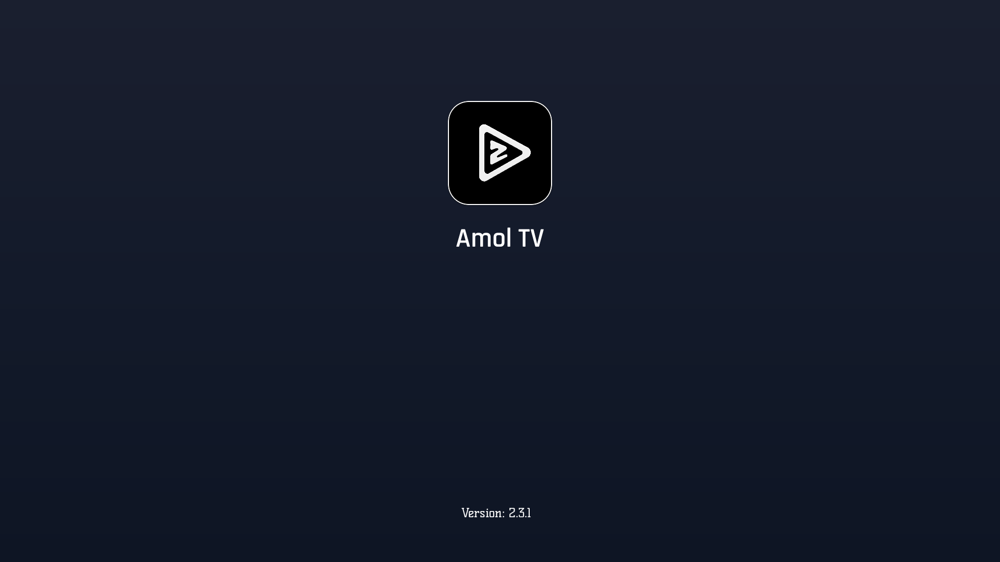
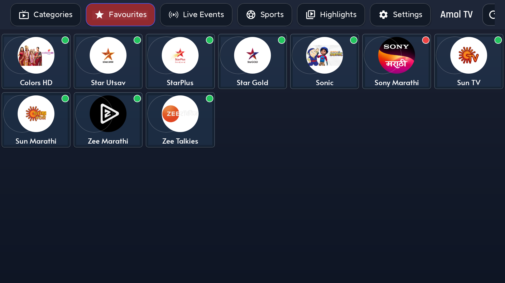
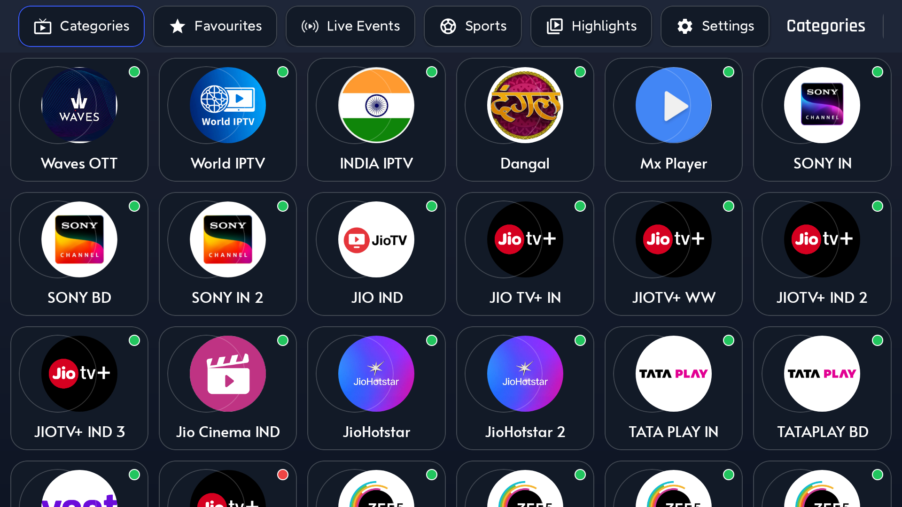
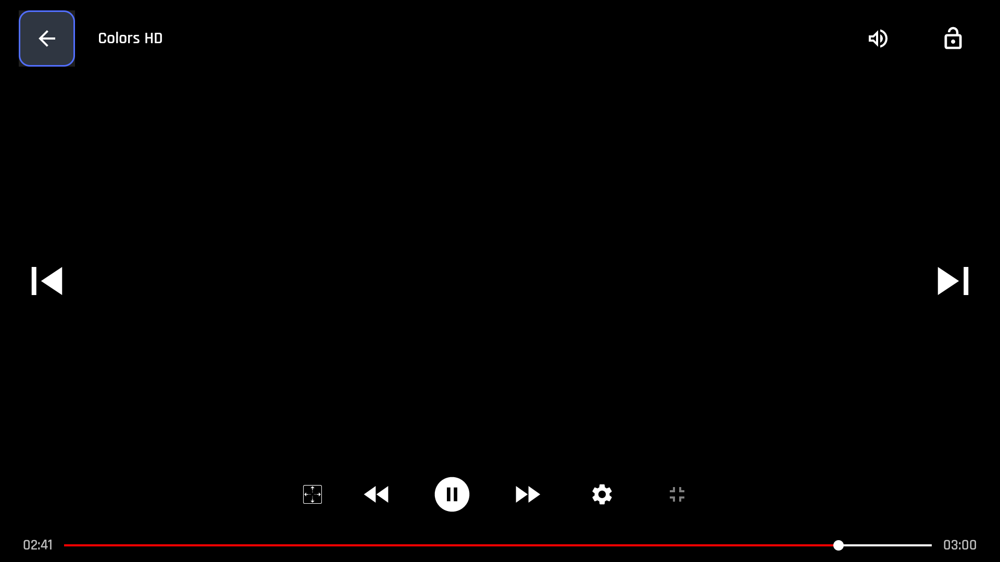

# Amol TV

Modified Android TV APK based on Live TV, rebranded as **Amol TV**.

• Live Sports Streaming: Gives free access to major domestic and international events including cricket, football, hockey, and WWE.

• All-in-One Entertainment: Offers live television networks, on-demand movies, and TV shows alongside sports.

• Device Compatibility: Mainly distributed as an Android APK, it is also frequently configured for Firestick and Android TV boxes.


- All-in-One Entertainment- All TV Channels also Streaming Live TV Apps
- Startup tab: **Favourites**
- Top tabs order: Categories → Favourites → Live Events → Sports → H → Settings
- Green / red online–offline status dots on channel logos
- Favourites **Export / Import** buttons (saves to `Download/AmolTV/favourites.json`, with app-files fallback)
- Long-press a favourite → **Move left / Move right / Export all / Remove**

## Screenshots

### Splash



### Home (Favourites)



### Categories



### Player



## Favourites file + reorder

On the **Favourites** tab:

1. Use **Export** / **Import** (top-right) to save or restore the list.
2. File path: `Download/AmolTV/favourites.json` (or app Documents if Download is blocked).
3. Long-press a channel → **Move left** / **Move right** to change position, or **Remove**.

Copy `favourites.json` to another TV and tap **Import** to restore the same list/order.

## Install on Android TV

### Option A — USB stick (no PC)

1. Copy `AmolTV.apk` (or `playztv-modded.apk`) to a USB drive.
2. Plug the USB into your Android TV.
3. Open a file manager on the TV (e.g. **CX File Explorer**, **X-plore**, or the built-in Files app).
4. Open the USB drive and select the APK.
5. If prompted, allow **Install unknown apps** for that file manager.
6. Tap **Install**, then **Open**.

### Option B — ADB over network (PC)

1. On the TV: **Settings → Device Preferences → About → Build** — tap Build until Developer options unlock.
2. Enable **Developer options → USB debugging** (and **Network debugging** / ADB over network if shown).
3. Note the TV IP (Wi‑Fi / Ethernet settings), e.g. `192.168.1.34`.
4. On your PC (Android SDK platform-tools installed):

```bash
adb connect 192.168.1.34:5555
adb install -r AmolTV.apk
adb shell am start -n com.playz.tv/com.playz.tv.activities.SplashActivity
```

5. The app should appear on the launcher as **Amol TV**.

### Option C — Sideload from phone / Downloader

1. Host `AmolTV.apk` somewhere reachable on your LAN, or use a transfer app.
2. On the TV, open **Downloader** (or similar) and enter the file URL / code.
3. Download the APK, allow unknown sources if asked, then install.

## Notes

- Files:
  - `AmolTV.apk` — installable build
  - `pic/` — screenshots used above
